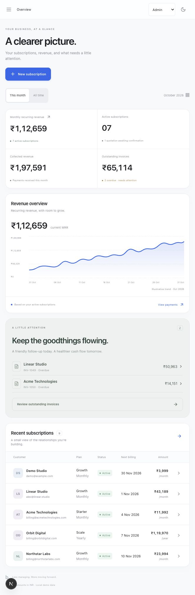

# Brightloop

**A clearer view of subscriptions, billing, and recurring revenue.**

Brightloop is an interactive subscription-management frontend built for the Odoo Hackathon. It brings plans, customers, subscription lifecycles, invoices, and payments into one responsive workspace, with separate Admin, Staff, and Customer previews.

The main demonstration follows a complete operational flow:

**Create a subscription → prepare a quotation → confirm and activate → generate an invoice → record payment → see the dashboard update.**

> **Project status:** Working frontend demo with browser-local persistence. Authentication, role enforcement, payment collection, and recurring billing automation are not connected to a backend. No real money is collected or emails sent.



## Contents

- [Problem and approach](#problem-and-approach)
- [Technology stack](#technology-stack)
- [Getting started](#getting-started)
- [Available commands](#available-commands)
- [Features and role previews](#features-and-role-previews)
- [Demo walkthrough](#demo-walkthrough)
- [Billing rules and calculations](#billing-rules-and-calculations)
- [Data and persistence](#data-and-persistence)
- [Project structure](#project-structure)
- [Design and accessibility](#design-and-accessibility)
- [Validation](#validation)
- [Current limitations and next steps](#current-limitations-and-next-steps)
- [Troubleshooting](#troubleshooting)

## Problem and approach

The supplied [Subscription Management System problem statement](problem%20statement/Subscription_Management_System.pdf) describes Brightloop Software, a business managing recurring products and plans through spreadsheets, manually prepared invoices, and disconnected payment records.

Its recurring problems are missed renewals, billing mistakes, slow reconciliation, and limited visibility into revenue. This implementation demonstrates a single workspace where the team can follow a subscription from its first draft to a paid invoice, while customers can inspect and manage their own subscriptions.

This repository contains a standalone Next.js application. It does **not** contain an Odoo module or an integration with an Odoo server.

## Technology stack

| Technology | Purpose |
| --- | --- |
| Next.js 16, App Router | Application entry point, development server, and production build |
| React 19 | Interactive screens and component state |
| TypeScript | Typed plans, subscriptions, invoices, payments, and roles |
| Tailwind CSS 4 and custom CSS | Styling pipeline, design tokens, responsive layouts, and themes |
| Framer Motion 12 | Page transitions, shared navigation indicators, dialogs, and toggles |
| Lucide React | Interface icons |
| Browser `localStorage` | Persistence for demo records and appearance |
| Node.js test runner with `tsx` | Billing and calendar regression tests |

The exact installed dependency versions are recorded in `package-lock.json`. System fonts are used; no external font download is required.

## Getting started

### Prerequisites

- Node.js and npm installed. Development and build verification for this repository used **Node.js 26.7.0** and **npm 11.19.0**; other versions have not been verified here.
- Git, to clone the repository.
- A browser with JavaScript and local storage enabled.

No database, API key, environment file, or external account is required for the demo.

### Install and run

```sh
git clone https://github.com/Axshatt/odoo_hackathon.git
cd odoo_hackathon
npm ci
npm run dev
```

Open [http://localhost:3000](http://localhost:3000).

The development command binds to `0.0.0.0`, so the preview may also be reachable from other devices on your network, subject to your network configuration. The role selector in the header changes the demo perspective; login credentials are not required.

### Run a production build locally

```sh
npm run build
npm start
```

Open the address printed by the server. Building the application does not add authentication, a database, or payment processing; it serves the same frontend demo in production mode.

## Available commands

| Command | Description |
| --- | --- |
| `npm ci` | Install dependencies using the committed lockfile |
| `npm run dev` | Start the development server with automatic updates |
| `npm run typecheck` | Check TypeScript without emitting compiled files |
| `npm test` | Run the billing tests in `lib/billing.test.ts` |
| `npm run build` | Create an optimized Next.js production build |
| `npm start` | Serve an existing production build |

There is no configured lint command or automated browser-test suite in this repository.

## Features and role previews

### Workspace screens

| Screen | Implemented behavior |
| --- | --- |
| Overview | Calculated MRR, active subscriptions, collected revenue, outstanding balances, overdue invoice shortcuts, and recent subscriptions |
| Subscriptions | Create records, search by customer or subscription number, filter by status, and inspect lifecycle details |
| Products & plans | Browse monthly and annual plans; admins can create additional plans |
| Invoices | Generate from active subscriptions, confirm or cancel, filter and search, print, and export invoice records to CSV |
| Payments | View recorded payments and open their linked invoices |
| Customers | Browse and search a directory derived from subscription records |
| Settings | Change appearance, inspect demo scope, and access admin billing defaults and team entries |
| Account dialogs | Preview login, signup, and password-reset forms without creating accounts or sending email |

### Role behavior

| Capability | Admin | Staff | Customer |
| --- | --- | --- | --- |
| View all customer subscription records | Yes | Yes | No; Linear Studio records only |
| Create subscription drafts and advance quotation stages | Yes | Yes | No; customer plan selection creates an active demo subscription |
| Pause, resume, close, and renew subscriptions | Yes | Yes | Own demo subscriptions |
| Generate, confirm, or cancel invoices | Yes | Yes | No |
| Record a full payment | Yes | Yes | Own confirmed invoices through a demo payment action |
| Browse available plans | Yes | Yes | Yes |
| Create plans | Yes | No | No |
| Change tax and discount defaults | Yes | No | No |
| Add staff entries | Yes | No | No |

**These are interface previews, not security boundaries.** The entire demo store exists in the browser. Customer filtering uses the seeded `alex@linear.studio` identity, and staff entries are display records rather than real accounts. Server-side authorization is required before using real customer data.

## Demo walkthrough

### 1. Create a subscription

1. Select **Admin** in the header.
2. Choose **New subscription**.
3. Enter a customer name and billing email.
4. Choose a plan, seat quantity, start date, and optional approved discount.
5. Select **Create draft subscription**.

The new record appears in Subscriptions with a generated identifier and a calculated next billing date.

### 2. Advance the lifecycle

Open the subscription and use its available actions:

```text
Draft → Quotation → Confirmed → Active
                                  ↓
                                Paused → Active

Subscriptions can be closed, then renewed to Active.
```

The selected state controls which actions appear. For example, invoice generation is available only after activation.

### 3. Generate and confirm an invoice

1. Select **Generate invoice** on the active subscription.
2. Review the subtotal, discount, tax, total, and billing period.
3. Select **Confirm invoice**.

A second non-cancelled invoice for the same subscription and billing period is blocked. Cancelling an invoice allows a replacement for that period.

### 4. Record payment

1. Select **Record payment** on the confirmed invoice.
2. Choose Bank transfer, UPI, or Card.
3. Enter the payment date and an optional reference or note.
4. Submit the full payment.

The invoice becomes **Paid**, the payment appears in history, and collected revenue updates. If the paid invoice corresponds to the subscription's current next billing period, the next date advances by one plan cycle. Paying an older invoice does not advance an unrelated current billing date.

The payment method is descriptive demo data. No gateway or bank is contacted.

### 5. Explore the customer portal

Switch to **Customer** to view Linear Studio's records. Browse plans, add a demo subscription, inspect invoices, and try pause, resume, close, or renewal actions. Switch to **Staff** to explore operational controls without admin-only configuration.

### 6. Try reporting and appearance

- Search and filter subscriptions or invoices.
- Open an overdue invoice from the overview.
- Export invoices from the Invoices screen. The CSV contains all invoices available to the current role, not just the current search/filter result.
- Print an invoice from its detail dialog.
- Toggle light/dark appearance in the header or Settings.
- Refresh the page to verify browser-local persistence.

## Billing rules and calculations

### Seeded plans

| Plan | Price per seat before tax | Billing cycle |
| --- | --- | --- |
| Starter | ₹1,499 | Monthly |
| Growth | ₹3,999 | Monthly |
| Scale | ₹39,990 | Yearly |

Plan feature descriptions are presentation copy; advertised entitlements such as team-size limits are not enforced. The subscription form accepts between 1 and 10,000 seats.

### Invoice calculation

Defaults are **18% tax** and an available **10% seat discount**. An admin can change these defaults in Settings. Discount selection is stored on each new subscription; changing the default does not rewrite existing subscriptions. Tax is calculated when an invoice is generated, and existing invoice totals are retained.

```text
subtotal = plan price × seats
discount = round(subtotal × subscription discount percentage / 100)
tax      = round((subtotal − discount) × current tax percentage / 100)
total    = subtotal − discount + tax
```

For 12 Growth seats with a 10% discount and 18% tax:

| Line | Amount |
| --- | --- |
| Subtotal | ₹47,988 |
| Discount | −₹4,799 |
| Tax | ₹7,774 |
| Total | **₹50,963** |

The demo rounds discount and tax to whole rupees and formats currency using the Indian numbering system. A production billing service should define its own minor-unit precision and rounding policy.

### Dashboard definitions

- **Monthly recurring revenue:** Sum of active subscription values after discount, before tax. Yearly plans are divided by 12 to produce a monthly equivalent.
- **Active subscriptions:** Records whose status is exactly `Active`; paused, closed, and draft records are excluded.
- **Collected revenue:** Recorded payments in the current month or across all time, according to the selected period.
- **Outstanding invoices:** Total of invoices in `Confirmed` status, including those not yet overdue.
- **Overdue invoices:** Confirmed invoices with a due date earlier than today. Overdue is a derived display condition, not a separate stored invoice status.

The period selector affects collected revenue. Active subscription counts and MRR remain current snapshots. **The chart's historical curve is illustrative and explicitly labeled; it is not a historical revenue dataset.**

### Dates and renewals

Monthly and annual date calculations clamp to a valid day at month-end. For example, January 31, 2026 advances to February 28, 2026, and February 29, 2024 advances to February 28, 2025 for an annual cycle.

An invoice's period and due date both use the subscription's next billing date. Generation is manual and can occur before that date; there is no scheduler or configurable payment-term calculation. The `today()` helper uses a UTC date, while some display labels use browser-local formatting.

## Data and persistence

The initial dataset contains three plans, eight subscriptions, six invoices, four payments, and one staff entry. The seeded customer is **Alex Lee at Linear Studio**.

Seed records use October–November 2026 dates. Consequently, “This month” revenue and overdue labels depend on when you run the app. Use **All time** to inspect all seeded payments outside October 2026.

| Storage key | Contents |
| --- | --- |
| `brightloop-v1` | Subscriptions, invoices, payments, plans, tax rate, discount default, and staff entries |
| `brightloop-theme` | Saved light/dark appearance |

Persistence is local to the browser profile and origin. A different device, browser, hostname, or port can have a separate dataset. There is no server synchronization, multi-tab conflict handling, migration system, or shared database. Role selection and the current screen are not persisted.

### Reset the demo

To discard local demo changes, clear these two keys using the browser's storage tools, then reload. Alternatively, run the following in the browser console while on the app:

```js
localStorage.removeItem("brightloop-v1");
localStorage.removeItem("brightloop-theme");
window.location.reload();
```

This restores seeded records and clears the saved appearance preference. It cannot recover browser-only records you have removed.

## Project structure

```text
odoo_hackathon/
├── app/
│   ├── globals.css          # Tokens, themes, layouts, responsive and print styles
│   ├── layout.tsx           # Document shell and metadata
│   └── page.tsx             # App Router entry point
├── components/
│   └── workspace.tsx        # Workspace screens, state, forms, and shared UI
├── lib/
│   ├── billing.ts           # Domain types, seed records, calculations, date helpers
│   └── billing.test.ts      # Billing and calendar regression tests
├── problem statement/
│   └── Subscription_Management_System.pdf
├── brightloop-preview.png   # Saved interface preview
├── AGENTS.md                # Repository guidance for coding agents
├── package.json             # Dependencies and scripts
├── package-lock.json        # Reproducible dependency lockfile
├── postcss.config.mjs       # Tailwind/PostCSS integration
├── tsconfig.json            # TypeScript configuration
└── README.md
```

### State flow

`app/page.tsx` renders the client-side `Workspace`. On initial use, the workspace loads seed records or restores saved browser data. UI actions update the typed React store, which is then saved to local storage. Metrics and filtered views are derived from that store.

`lib/billing.ts` isolates invoice creation and date logic. Other transitions, payment recording, form handlers, and persistence currently live in `components/workspace.tsx`. There are no API routes or database calls. Navigation switches client-side views on the root page; individual screens do not have shareable routes.

### Common customization points

| Change | Location |
| --- | --- |
| Seed plans, prices, or sample customers | `lib/billing.ts` |
| Invoice arithmetic and renewal dates | `lib/billing.ts` |
| Colors, surfaces, radii, responsive rules | `app/globals.css` |
| Navigation, forms, role previews, and screen copy | `components/workspace.tsx` |
| Motion spring values | `components/workspace.tsx` |
| Browser title and description | `app/layout.tsx` |

Changes to seeded records will not replace an existing browser store automatically. Reset local demo data to inspect revised seeds.

## Design and accessibility

The interface prioritizes operational clarity: an asymmetric overview, a compact navigation rail, generous spacing, and focused dialogs for billing actions.

| Token or behavior | Choice |
| --- | --- |
| Main accent | `#0071e3` in light mode; brighter blue in dark mode |
| Canvas and surfaces | Off-white canvas, white panels, and near-black text; CSS-variable dark equivalents |
| Typography | Native system stack with SF Pro / Inter fallbacks; tightly tracked headings and tabular amounts |
| Corner radii | Approximately 10–12px controls and 22–26px panels/dialogs |
| Depth | Hairline borders and soft, low-opacity shadows |
| Glass | Blur and saturation on the sticky header |
| UI springs | Stiffness `340`, damping `32`, mass `1` |
| Page transitions | 12px vertical travel over 250ms |
| Card hover | 4px upward lift |
| Status color | Restrained sage and amber alongside the primary blue accent |

The implementation includes semantic forms and tables, labeled dialogs, native dialog keyboard behavior, visible focus rings, a skip-to-content link, touch-friendly controls, and reduced-motion handling through CSS and Framer Motion. Tables scroll within their containers on narrow screens; mobile navigation uses a collapsible sidebar.

These features have been manually inspected, but the project has not undergone a comprehensive accessibility audit or formal WCAG certification.

## Validation

Run:

```sh
npm run typecheck
npm test
npm run build
```

The automated tests cover:

1. Discount-before-tax arithmetic and duplicate invoice prevention.
2. Rejection of invoice creation for non-active subscriptions.
3. Valid month-end and leap-year renewal dates.

During implementation, the production build and TypeScript checks passed. Manual browser checks covered the subscription-to-payment sequence, dashboard updates, customer invoice filtering, desktop and phone layouts, and light/dark appearance. A phone-width horizontal overflow issue was identified and fixed.

These checks do not establish production payment reliability, secure authorization, or performance with thousands of subscriptions.

## Current limitations and next steps

| Area | Current demo | Further implementation needed |
| --- | --- | --- |
| Identity | Login/signup/reset form previews | Real accounts, unique-email checks, sessions, reset delivery, and server authorization |
| Product catalog | Plans and per-seat prices | Independent products, variants, cost prices, and product notes |
| Plan rules | Monthly/yearly cycles and basic transitions | Daily/weekly cycles, availability windows, expiry, and plan-specific lifecycle permissions |
| Quotations | Quotation stage on subscriptions | Reusable templates, product lines, validity periods, and formal quotation documents |
| Invoicing | Manual generation and browser-local duplicate checks | Scheduled batch billing, payment terms, transactional idempotency, and delivery |
| Discounts | A selected percentage per subscription | Fixed discounts, eligibility thresholds, product targeting, expiry, and usage limits |
| Payments | Full payment records | Gateway integration, partial payments, webhooks, reconciliation, refunds, and retries |
| Reporting | Current calculated metrics and illustrative chart | Historical data, date-range reports, pagination, and larger-dataset benchmarks |
| Team | Admin-added staff names | Invitations, account provisioning, and permission management |
| Persistence | Browser storage | Shared database, validation, migrations, audit history, and backup/restore |

A practical next step is to extract workspace state mutations into a service layer, add authenticated API endpoints and a transactional database, then connect a billing scheduler and payment provider. Database-backed uniqueness and idempotency should replace browser-local duplicate checks before real invoicing is enabled.

## Troubleshooting

| Symptom | What to check |
| --- | --- |
| Port 3000 is busy | Run `npm run dev -- --port 3001`, then open the address printed in the terminal |
| `npm start` cannot find a build | Run `npm run build` first |
| Seed changes do not appear | Existing local storage takes precedence; reset the demo keys and reload |
| Records differ between browsers or devices | Storage is browser- and origin-specific; cross-device sync is not implemented |
| “This month” shows no seeded revenue | Seeded payments are dated October 2026; choose All time or record a demo payment dated this month |
| Invoice generation is rejected | Activate the subscription and check whether a non-cancelled invoice already exists for its current billing period |
| Admin controls are missing | Select Admin in the header role picker |
| Changes do not survive a reload | Ensure browser storage is available and is not being cleared by private-session or browser settings |

If you change billing behavior, add a focused regression test in `lib/billing.test.ts` and rerun the checks above. For UI changes, review both themes and a narrow mobile viewport before considering the change complete.
